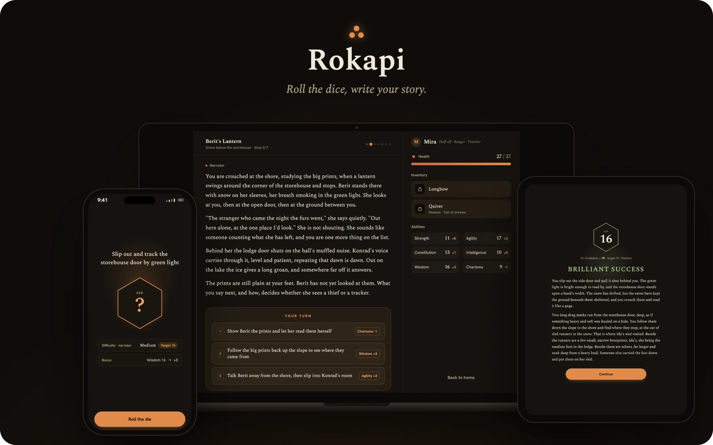
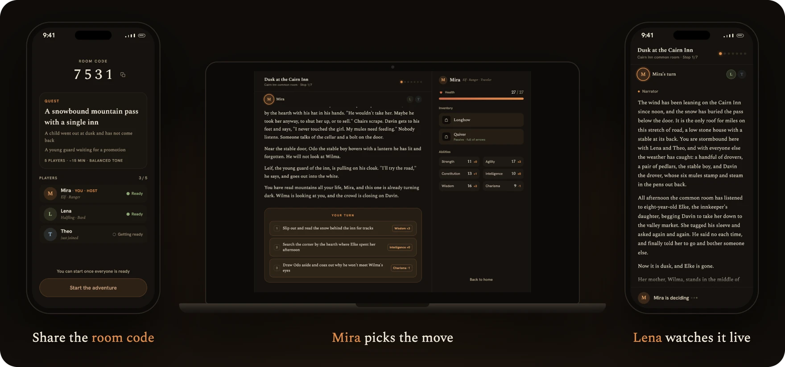
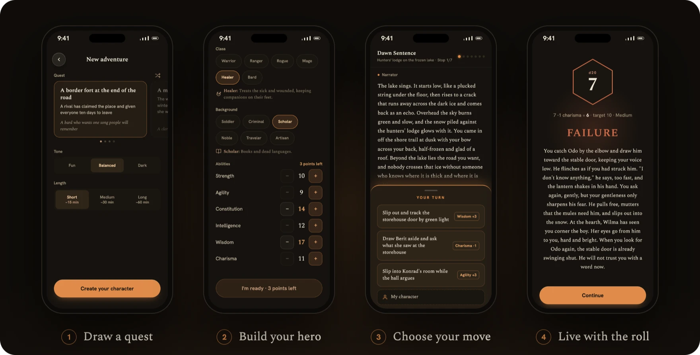

<p align="center">
  
</p>

<p align="center">
  <b>A tabletop adventure, told by an AI narrator.</b><br>
  Play alone or with up to four friends, in the browser or on iOS and Android.
</p>

<br>

An AI narrator writes every scene around your choices and your dice, and plays it out to an ending you earned. No two games tell the same story. Play in English or Turkish; a game takes 15 minutes to an hour.

[Rokapi](https://en.wikipedia.org/wiki/Georgian_mythology#Spirits,_creatures,_and_other_beings) (როკაპი) is an evil spirit in Georgian mythology, chained to a column under the earth.

Rokapi isn't hosted yet. To play, run it yourself (see [Development](#development)).


## Play together

<p align="center">
  
</p>

Open a room and share its four-digit code. Friends join from whatever they have at hand (laptop, tablet or phone), each with their own hero.

The whole party reads the same scene as the narrator writes it. On your turn you pick the move and roll; everyone else sees what you tried and reads what it cost you. When the adventure ends, take the same party straight into the next one.


## How a game plays

<p align="center">
  
</p>

1. **Draw a quest.** A place, a trouble and a person. Or take a surprise quest and find out as you play. Pick a tone (fun, balanced or dark) and a length (about 15, 30 or 60 minutes).
2. **Build your hero.** A race, a class and a background, and points to spread across six abilities.
3. **Choose your move.** Every scene ends in two or three choices, each tied to one of your abilities.
4. **Live with the roll.** Roll a d20. A good roll opens a way; a bad one costs you health, items or worse.
5. **Reach the finale.** The last scene's roll ends the story. What you uncovered and how your rolls went decide whether you win, unless the party falls first.


## A narrator that plays fair

- **Every quest hides a twist.** Only the narrator knows it; good rolls uncover it clue by clue.
- **The dice matter.** A clean success never costs you health, and a failure only hurts as much as the roll was bad.
- **Nothing is forgotten.** Health, items and statuses carry from scene to scene, and the ending remembers how it all began.


## Keep what you played

Finished adventures are kept to read again. Badges mark the memorable ones, like a natural 20 in the finale or a full party of five with every hero still standing. Places seen tracks which of the 20 places you have visited and which are still out there.


## Development

An LLM will happily write prose all day. The hard part is getting it to tell a story worth playing: one that holds an arc, respects the dice, and makes you want the next scene, rather than improvising a fresh reply every turn.

Rokapi is a Rails 8 application: vanilla Rails, Hotwire, SQLite. LLM calls go through [RubyLLM](https://rubyllm.com). The iOS and Android apps are [Hotwire Native](https://native.hotwired.dev) shells around the same screens; they live in `native/` (`native/README.md`).

### Running it locally

- Ruby 4.0.9, then `bin/setup`.
- The narrator needs an OpenAI key in the credentials as `openai.api_key`.
- Login is by email with a one-time code; in development the mail is written to `tmp/mails/`.
- `bin/rokapi` plays the game against a running server, one UI step per command (`bin/rokapi help`).

### Tests

```
bin/rails test
```

The suite stubs the LLM; no API key is needed and nothing is sent anywhere.

### Deployment

Rokapi deploys with [Kamal](https://kamal-deploy.org). The configuration in `config/deploy.yml` is a placeholder until the first production deploy.


## Status

Rokapi is a personal side project and very much in progress. Things change without notice. Ideas and bug reports are welcome; open an issue.


## License

Rokapi is released under the [PolyForm Noncommercial License 1.0.0](LICENSE.md).
